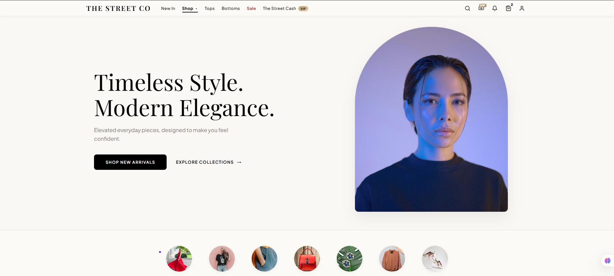
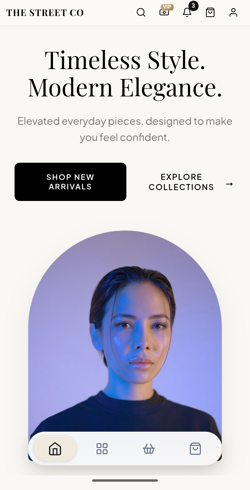
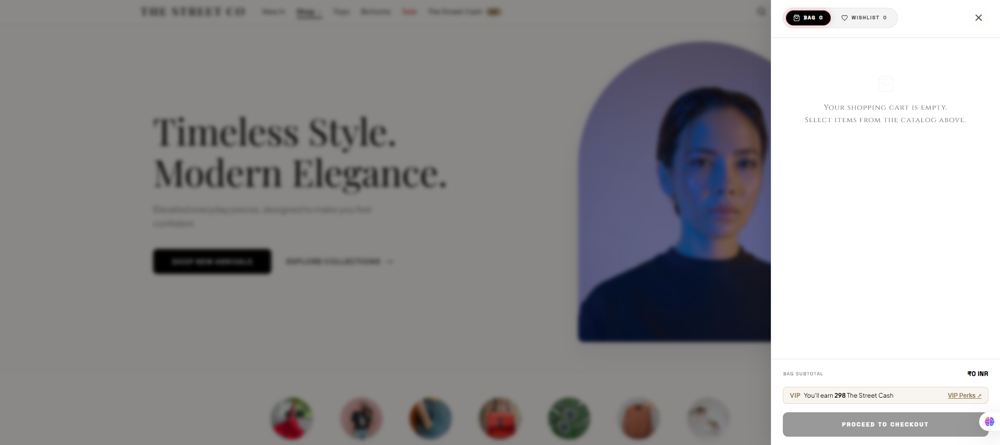
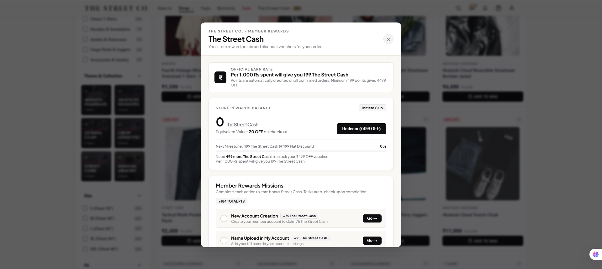
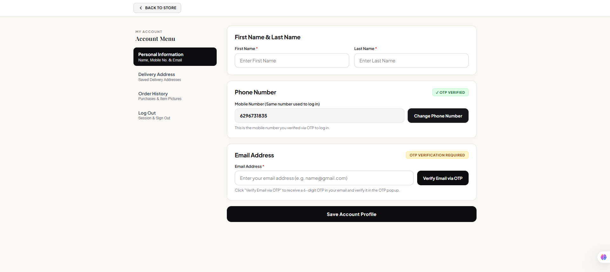
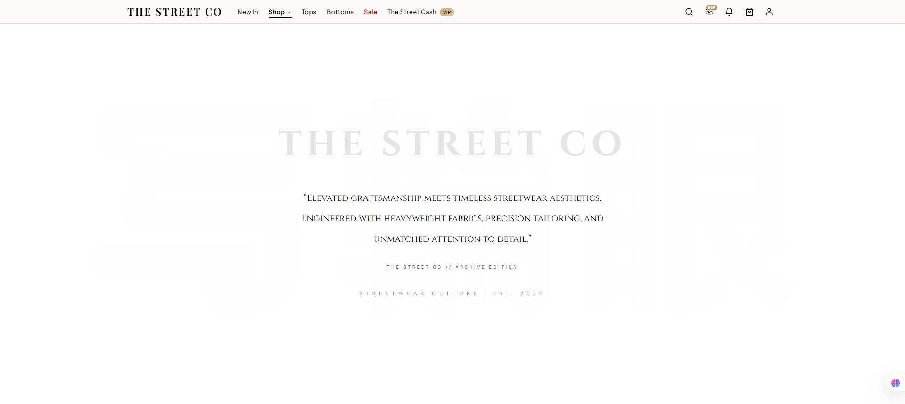
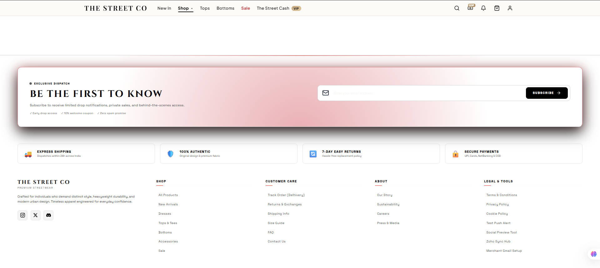
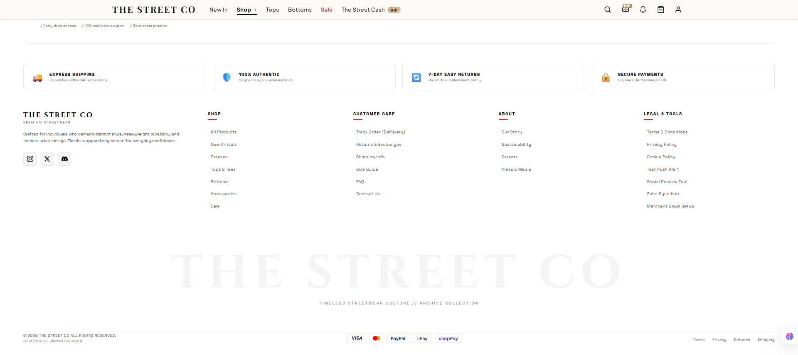

# The Street Co — Elevated Streetwear & Modern Essentials

[](https://nodejs.org/)
[](https://expressjs.com/)
[](https://www.mongodb.com/atlas)
[](https://firebase.google.com/)
[](https://www.zoho.com/inventory/)
[](https://web.dev/progressive-web-apps/)
[](LICENSE)

> **The Street Co** is a full-stack Direct-to-Consumer (D2C) e-commerce progressive web application engineered for modern streetwear culture. Featuring live Delhivery reverse-courier logistics, 7-day doorstep size exchange & refund returns, automated Zoho Inventory sales invoices, MongoDB Atlas cloud storage, and **The Street Cash** gamified loyalty reward engine.

---

## Visual Showcase & UI Gallery

### 1. Desktop Hero Experience
*Clean, typography-driven luxury streetwear aesthetic featuring curated collections, active drop banners, and category navigation.*



---

### 2. Mobile Progressive Web App (PWA)
*Engineered mobile-first with native-feel bottom navigation bar, touch-optimized swiping, and installable offline support.*

<p align="center">
  
</p>

---

### 3. Slide-Out Shopping Bag & Live Subtotal Drawer
*Instant slide-over bag featuring live subtotal calculation, free shipping threshold indicator, VIP Street Cash earn calculator, and 1-click checkout gate.*



---

### 4. "The Street Cash" VIP Member Rewards Modal
*Gamified loyalty program rewarding ₹199 Street Cash points per ₹1,000 spent, milestone discount voucher unlocks (₹499 Flat OFF), and bonus reward missions.*



---

### 5. Customer Account & OTP Verification Portal
*Comprehensive account management featuring Firebase phone number OTP verification, email OTP verification, order history, and saved delivery address book.*



---

### 6. Editorial Brand Narrative & Archive Collection
*Luxury editorial manifesto celebrating heavyweight fabric tailoring, authentic craftsmanship, and urban anime-inspired apparel.*



---

### 7. VIP Drop Access & 4-Pillar Trust Guarantees
*Limited drop early-access email subscription with service commitments: Express 24h shipping, 100% authentic garments, 7-day easy returns, and multi-rail payment security.*



---

### 8. Reverse Logistics & Enterprise Footer
*Complete operational footer providing live courier tracking, returns and exchanges portal, sizing guides, and Zoho Inventory sync monitor.*



---

## Key Features

### 🛒 D2C Storefront & Product Engine
- **Curated Streetwear Drops**: Heavyweight oversized t-shirts, tactical cargo joggers, drop-shoulder hoodies, and collector jackets.
- **Dynamic Sizing System**: Interactive size selector (`XS`, `S`, `M`, `L`, `XL`, `XXL`) with live inventory availability checks.
- **Delhivery Pincode Checker**: Instant pincode serviceability calculator checking courier availability and dynamic 3-day estimated delivery dates.
- **Price Drop Alerts**: Targeted email notification subscription modal alerting customers whenever their favorite garments drop in price.
- **High-Resolution Gallery Lightbox**: Edge-to-edge product zoom viewer with crisp white text labels and mobile tap support.

### 🔄 7-Day Doorstep Returns & Exchanges
- **Free Size Exchange**: Request a replacement size (`XS`–`XXL`) with doorstep courier reverse collection.
- **Full Purchase Refund**: Return items directly for a 100% refund without requiring a replacement size.
- **Automated Reverse Logistics**: Instant generation of reverse courier tracking numbers (`STC-REV-*****`).
- **One-Click Cancellation**: Full server-backed cancellation via `POST /api/returns/cancel`, automatically synchronizing MongoDB Atlas, local caches, and order cards.

### 💰 "The Street Cash" Loyalty Club
- **Automated Earn Rate**: Automatically earn ₹199 Street Cash for every ₹1,000 spent on confirmed orders.
- **Milestone Rewards**: Reach 499 points to unlock ₹499 instant discount vouchers on checkout.
- **Gamified Missions**: Complete onboarding steps (Account Creation: +75 pts, Profile Setup: +25 pts) to build point balance.

### 🔐 Multi-Channel Customer Authentication
- **Phone OTP Verification**: Direct Firebase phone number verification badge.
- **Email OTP Verification**: 6-digit email confirmation code dispatched via Gmail SMTP.
- **Multi-Address Management**: Saved shipping book with default address designation and pincode auto-fill.

### ⚡ Enterprise Integrations
- **Zoho Inventory & Invoice**: Automatic sales order syncing, official Zoho invoice generation (`#INV`), and sales return dispatching.
- **MongoDB Atlas Persistence**: Cloud document database for orders, users, address books, and return records with zero data loss.
- **Delhivery Express Integration**: Real-time reverse pickup scheduling and parcel dispatch tracking.
- **Google Gmail SMTP**: Transactional email dispatch for order confirmations, exchange approvals, and price-drop notifications.

---

## Tech Stack

| Layer | Technologies |
|---|---|
| **Frontend** | Vanilla JavaScript (ESModules), Semantic HTML5, Tailwind CSS, Modern Flex/Grid Layouts |
| **Mobile & PWA** | Service Worker (`sw.js`), Web App Manifest (`manifest.json`), Apple Touch Icons, Offline Cache |
| **Backend** | Node.js (v20+), Express.js REST API |
| **Database** | MongoDB Atlas (`mongodb` driver v7.7), File-backed fallback cache (`orders_cache.json`) |
| **Authentication** | Firebase Authentication (Phone OTP, Email Verification) |
| **Logistics & ERP** | Zoho Inventory API, Zoho Invoice, Delhivery Reverse Logistics |
| **Communications** | Nodemailer (Gmail SMTP), Twilio SMS Gateway |

---

## Project Structure

```
the-street-co/
├── docs/
│   └── screenshots/              # High-resolution README UI showcase images
│       ├── 01-hero-desktop.png
│       ├── 02-cart-drawer.png
│       ├── 03-rewards-street-cash.png
│       ├── 04-account-profile-otp.png
│       ├── 05-editorial-manifesto.png
│       ├── 06-newsletter-guarantees.png
│       ├── 07-footer-logistics.png
│       └── 08-mobile-pwa.png
├── public/                       # Static public assets, favicons, PWA icons
│   └── assets/aistudio/          # Uploaded media assets
├── admin-og.html                 # Social preview & OpenGraph banner generator
├── admin-zoho.html               # Zoho Inventory synchronization dashboard
├── email-preview.html            # Transactional email template previewer
├── env.example                   # Environment variable template
├── firebase-auth.js              # Client-side Firebase authentication logic
├── firebase-blueprint.json       # Firebase schema blueprint
├── firestore.rules               # Firestore security rules
├── index.html                    # Main single-page application entry point
├── main.js                       # Frontend store logic, cart, accounts & return modal
├── manifest.json                 # PWA Progressive Web App manifest
├── metadata.json                 # Application metadata & capabilities
├── mongoDb.js                    # MongoDB Atlas connection pool & queries
├── package.json                  # NPM dependencies and run scripts
├── server.js                     # Express server & REST API endpoints
├── style.css                     # Global stylesheet with responsive Tailwind utilities
├── sw.js                         # Service worker for offline asset caching
└── zohoInventory.js              # Zoho Inventory OAuth2 client & sales order sync
```

---

## Getting Started

### Prerequisites
- [Node.js](https://nodejs.org/) (v18.0.0 or higher)
- [npm](https://www.npmjs.com/) (v9.0.0 or higher)
- A [MongoDB Atlas](https://www.mongodb.com/atlas) cluster (optional; in-memory/file fallback included)
- A [Zoho Inventory](https://www.zoho.com/inventory/) account (optional for ERP sync)

### Installation

1. **Clone the repository:**
   ```bash
   git clone https://github.com/YOUR_USERNAME/the-street-co.git
   cd the-street-co
   ```

2. **Install dependencies:**
   ```bash
   npm install
   ```

3. **Configure Environment Variables:**
   ```bash
   cp env.example .env
   ```
   Edit `.env` and fill in your credentials:
   ```env
   # Database
   MONGODB_URI=mongodb+srv://<user>:<password>@cluster0.mongodb.net/
   MONGODB_DB_NAME=thestreetco

   # Gmail SMTP Email Dispatch
   GMAIL_SMTP_USER=your-email@gmail.com
   GMAIL_SMTP_PASS=your-app-password
   GMAIL_SENDER_NAME=The Street Co

   # Zoho Inventory (Optional)
   ZOHO_INVENTORY_CLIENT_ID=your_client_id
   ZOHO_INVENTORY_CLIENT_SECRET=your_client_secret
   ZOHO_INVENTORY_REFRESH_TOKEN=your_refresh_token
   ZOHO_INVENTORY_ORG_ID=your_org_id

   # Server Port
   PORT=3000
   NODE_ENV=production
   ```

4. **Start the development server:**
   ```bash
   npm run dev
   ```
   Or for production:
   ```bash
   npm start
   ```

5. **Open in browser:**
   Navigate to `http://localhost:3000` to browse the store.

---

## API Reference

### Orders
- `POST /api/orders` — Create a new order (calculates totals, awards Street Cash, dispatches email).
- `GET /api/account/orders?phone=<10_DIGITS>` — Retrieve order history for a customer's phone number from MongoDB Atlas.
- `POST /api/orders/lookup` — Query order status by order code.

### Returns & Exchanges
- `POST /api/returns/create` — Initiate a 7-day size exchange or full refund return with reverse AWB tracking.
- `POST /api/returns/cancel` — Cancel an active return/exchange request across MongoDB Atlas and local caches.
- `GET /api/returns` — List all registered return/exchange requests (merchant admin).
- `POST /api/returns/:id/confirm` — Approve return and schedule Delhivery doorstep courier.
- `POST /api/returns/:id/mark-refund-done` — Confirm customer refund and dispatch payment receipt.

### Logistics & Store Utility
- `GET /api/pincode/check?pincode=<PIN>` — Check Delhivery courier serviceability and estimated delivery arrival.
- `POST /api/newsletter/subscribe` — Register an email address for limited-drop alerts and price drop updates.
- `GET /api/zoho-inventory/status` — Inspect live Zoho Inventory OAuth token status and cached product inventory.

---

## How to Make this Repository Public on GitHub

To publish this repository and make it public for the world to see:

### Method 1: Using GitHub CLI (`gh`)
If you have the [GitHub CLI](https://cli.github.com/) installed on your machine:
```bash
# 1. Initialize git and commit files
git init
git add .
git commit -m "feat: complete The Street Co platform with comprehensive README and UI showcase"

# 2. Create a new public repository and push
gh repo create the-street-co --public --source=. --remote=origin --push
```

### Method 2: Using the GitHub Web Interface
1. Go to [GitHub.com/new](https://github.com/new).
2. Set the repository name to `the-street-co`.
3. Choose **Public** under the visibility options.
4. Leave *"Initialize this repository with a README"* unchecked (we already have a complete one).
5. Click **Create repository**.
6. In your terminal, run:
   ```bash
   git init
   git add .
   git commit -m "feat: complete The Street Co platform with comprehensive README and UI showcase"
   git branch -M main
   git remote add origin https://github.com/YOUR_USERNAME/the-street-co.git
   git push -u origin main
   ```

### Method 3: Change an Existing Private Repository to Public
If your repository already exists on GitHub as **Private**:
1. Open your repository on GitHub (`https://github.com/YOUR_USERNAME/the-street-co`).
2. Click the **Settings** tab at the top right.
3. Scroll down to the **Danger Zone** section at the bottom.
4. Under **Change repository visibility**, click **Change visibility**.
5. Select **Make public**.
6. Type the repository confirmation name and confirm. Your repository is now public!

---

## License

This project is licensed under the [MIT License](LICENSE). Built with craftsmanship for streetwear enthusiasts.
